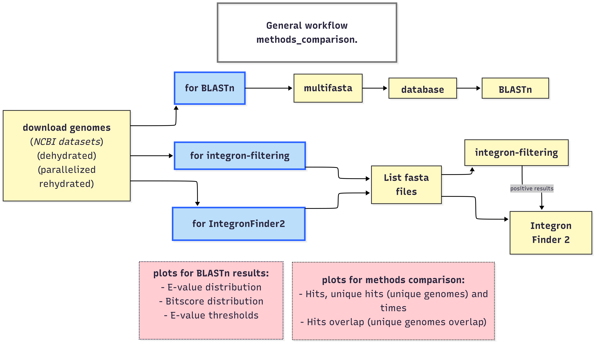

# Development of a bioinformatics pipeline for the classification of class 1 integrons by species and environment.

Bioinformatics pipeline for detecting class 1 integrons and classifying their Pc promoter variants in ESKAPEE Gram-negative bacteria.

The repository is organised in **two main blocks**:

1. [`methods_comparison`](#1-methods_comparison): compares different methods for searching and detecting class 1 integrons.
2. [General pipeline](#2-general-pipeline-pc-classification): runs the end-to-end workflow and classifies Pc variants using BLASTn.

---
## 0. Before starting

###  Installation

The pipeline runs in a conda environment, so you first need a conda distribution (such as [Miniconda](https://docs.conda.io/en/latest/miniconda.html) or [Anaconda](https://www.anaconda.com/download)).

To create the conda environment: 

```bash
# Create the environment from the .yml file included in the repository
conda env create -f environment.yml

# Activate it 
conda activate practicas
```

### Directory structure

Downloaded genomes and generated results are not stored inside the repository. 
They are saved in the parent folder of the repository, in two folders that must exist:

- `data_practicas/`: downloaded genomes and intermediate data.
- `results_practicas/`: results generated by the pipeline.

The only exceptions are the final aggregated CSV files and the generated plots, which are kept in the repository.

> To use different folder names or locations, update the corresponding paths in the code.

### Genome removal

In all cases, genomes with a negative result in the search are deleted to save disk space. 
The same applies to the general multi-FASTA files required by BLASTn.

---

## 1. `methods_comparison`

This block makes it possible to **compare different approaches for the search and detection of integrons** on the same set of genomes. The methods compared are:

| # | Method | Description |
|---|--------|-------------|
| 1 | **BLASTn with *intI1* sequences** | Three variants (see below) |
| 2 | **IntegronFinder2** | Run directly on the genomes |
| 3 | **IntegronFinder2 + `integron-filtering`** | IntegronFinder2 run after a prior filtering step |

The script used is [`methods_comparison.py`](./scripts/methods_comparison.py).

### 1.1 BLASTN variants

[BLASTn](https://github.com/evanpeikon/BLAST) is run using *intI1* reference sequences in three configurations:

- **[Query with a reference Pc](./data/Int1/Int1.fa)**: the query includes *intI1* plus one reference Pc .
- **[Query with a Pc pattern](./data/Int1/Int1_Pc_pattern.fa)**: the query includes a pattern so that any Pc variant is matched.
- **[Query without the Pc part](./data/Int1/Int1_no_Pc.fa)**: the query does not include the Pc region.

The FASTA files were generated with [this script](./scripts/additional/generate_Int1_fasta.py).

### 1.2 `integron-filtering` and its dependency (HattCI)

`integron-filtering` depends on [**HattCI**](https://github.com/maribuon/HattCI). 
It has to be installed manually:

1. **Clone the repository** ([maribuon/HattCI](https://github.com/maribuon/HattCI.git)) inside `scripts/T3_integronfiltering/`.
2. **Compile it with `make`**. This requires a C compiler (`gcc`, already included in the `.yml` environment file) and generates the binary `hattci.out`.

```bash
cd scripts/T3_integronfiltering
git clone https://github.com/maribuon/HattCI.git
cd HattCI
make
```

No further configuration is needed: the script [`scripts/integronfiltering.py`](./scripts/integronfiltering.py) automatically adds the HattCI directory to the `PATH` environment variable, so the binary is found at runtime.

> **Note:** the change to `PATH` only lasts while the script is running, so your system environment is never modified.

### 1.3 General workflow

Overview of how the `methods_comparison` block works:



*All diagrams in this README were created with [Mermaid](https://github.com/mermaid-js/mermaid).*

### 1.4 Internal workflow

#### BLASTn

Before running the searches, a BLAST database must be built from the genomes to be screened. 
A minimum hit length is applied so that the BLASTn definition of a hit is as close as possible to the one used by IF2 and `integron-filtering`, which makes the three methods comparable.

<!-- TODO: hacer el diagrama de funciones con blastn -->
#### IntegronFinder2 + integron-filtering

<!-- TODO: explicar todo lo de IF2 y integron-filtering -->
integron-filtering solo usamos el attC-screening.sh 

sin bbdd, se listan los fasta files, si da + para integron filtering --> pasa a IF2, sino nada

[IF2](https://github.com/gem-pasteur/Integron_Finder)  

*** explicar aquí un poco IF2 y el workflow en general
<!-- TODO: hacer el diagrama de funciones con IF2 e integron-filtering -->


### 1.5 Plotting results

Five final plots are generated.

**BLASTn results** (comparison between the three queries used):

- Boxplot of e-values: `evalue_distribution.png`
- Boxplot of bit scores: `bitscore_distribution.png`
- Number of hits at each e-value threshold: `evalue_thresholds.png`

**Comparison of the three methods**:

- Total hits and unique hits (number of distinct genomes with a hit): `method_comparison.png`
- Overlap between the sets of genomes with at least one hit: `hits_overlap.png`

### 1.6 Analyze results

Se ha generado un [script](./scripts/additional/analyze_methodscomparison.py) para analizar  los genomas discordantes.

---

## 2. General pipeline: Pc classification

This block is the general workflow. It performs the **classification of Pc promoter variants using BLAST**.
# FALTA TODA ESTA PARTE 

---

## 3. Analisis de la bbdd Integrall

Además, se analizan los datos correspondientes a la bbdd Integrall mediatne el [script](./scripts/T1_Integrall_Pc_abudance.py), obteniendo [resultados](./results/Integrall_analysis) sobre la abundancia relativa de las ESKAPEE en esta bbdd.


PENDIENTE:

- GUARDAR LOS PLOTS DE INTEGRALL E
